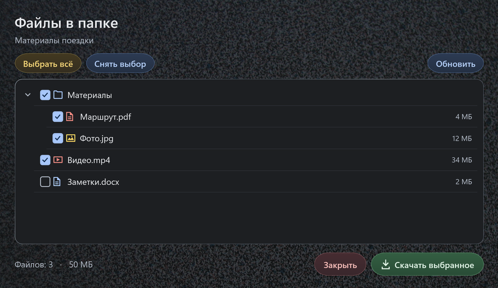
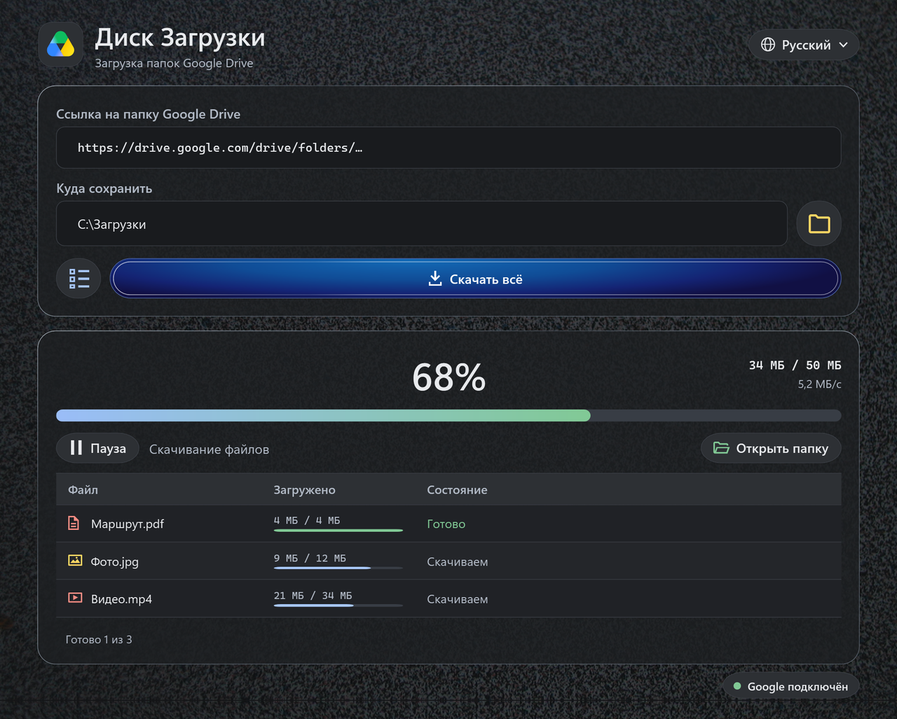

<h1 align="center">
  
</h1>

<div align="center">
  <p>Скачивайте папки Google Drive целиком или выбирайте отдельные файлы. Загрузчик сохраняет структуру папок и продолжает передачу после обрыва связи, если файл поддерживает докачку.</p>
  
  
  <a href="https://github.com/Mikhail-068/Gdisk_download/releases/tag/v1.0.0"></a>
  <p><strong><a href="https://github.com/Mikhail-068/Gdisk_download/releases/download/v1.0.0/DriveDownload-Setup-x64.exe">↓ Скачать установщик для Windows x64</a></strong></p>
  <p><a href="#установка">Установка</a> · <a href="#подключение-google-drive">Подключение Google Drive</a> · <a href="#загрузка-файлов">Загрузка файлов</a> · <a href="#решение-проблем">Помощь</a> · <a href="#лицензия">Лицензия</a></p>
</div>

## Установка

Запустите **`DriveDownload-Setup-x64.exe`** на Windows 10 или 11 x64. Среда .NET входит в комплект. Мастер работает для текущего пользователя, поэтому права администратора не нужны. После установки откройте **Диск Загрузки** из меню «Пуск».

[Страница выпуска v1.0.0](https://github.com/Mikhail-068/Gdisk_download/releases/tag/v1.0.0) · [Контрольная сумма SHA-256](https://github.com/Mikhail-068/Gdisk_download/releases/download/v1.0.0/SHA256SUMS.txt)

<details>
<summary>Папка установки, удаление и переносимый EXE</summary>

- Папка по умолчанию — `%LOCALAPPDATA%\Programs\DriveDownload`. Для удаления откройте **Параметры Windows → Приложения**. Скачанные файлы и настройки хранятся отдельно.
- `DriveDownload.exe` для прямого запуска можно получить [сборкой из исходников](#сборка-из-исходников). Он появится в папке `release`.

</details>

## Подключение Google Drive

Для первого запуска понадобится собственный проект Google Cloud с включённым **Google Drive API**. Выберите способ подключения по тому, кто может открыть папку.

| Доступ к папке | Что использовать |
| --- | --- |
| Доступ есть у вашего аккаунта или у конкретных людей | Вход через Google с OAuth Desktop |
| Файлы видны всем, у кого есть ссылка | Ключ API или вход через Google |

<details>
<summary>Вход через Google с OAuth Desktop</summary>

🎯 Сначала проверьте в браузере, что нужная папка открывается под вашим Google-аккаунтом. **Именно этот аккаунт выбирайте при входе в загрузчик.** Настраивать проект Google Cloud может другой аккаунт.

### Включите Google Drive API

1. Откройте Google Cloud Console. В верхней панели выберите проект или создайте новый, например **Диск Загрузки**. [Открыть Google Cloud Console](https://console.cloud.google.com/)
2. Перейдите в **APIs & Services → Library → Google Drive API** и нажмите **Enable**. Если уже видите **Enabled**, шаг готов. [Открыть страницу Drive API](https://console.cloud.google.com/apis/library/drive.googleapis.com)

<p align="center">
  
</p>

### Настройте экран входа

В том же проекте откройте **Google Auth Platform → Branding → Get Started**. Затем заполните три блока.

- 🏷️ **App Information.** Укажите имя приложения и выберите **User support email**. Это имя вы увидите при входе через Google.
- 👥 **Audience.** Выберите **External** для личного Gmail или людей за пределами вашей организации. **Internal** подходит для проекта Google Workspace, доступного только внутри организации.
- ✉️ **Contact Information.** Укажите адрес для уведомлений Google, примите условия и нажмите **Create**. [Справка по экрану согласия](https://developers.google.com/workspace/guides/configure-oauth-consent)

<details>
<summary>🖼️ Посмотреть поля на экране Branding</summary>


</details>

### Добавьте себя в Test users

Этот шаг нужен, если в **Audience** указаны **External** и **Testing**.

Откройте **Google Auth Platform → Audience**. Найдите раздел **Test users**, нажмите **Add users**, введите полный адрес аккаунта, которым будете входить, и нажмите **Save**.

💡 **Кого добавлять?** Укажите аккаунт, который открывает папку в Google Drive. **Test users** разрешает вход в приложение. Права на папку по-прежнему выдаёт её владелец. [Режимы OAuth в Google](https://developers.google.com/identity/protocols/oauth2/production-readiness/overview)

<p align="center">
  
</p>

### Разрешите чтение файлов

Откройте **Google Auth Platform → Data Access → Add or remove scopes**, добавьте строку ниже и сохраните изменения.

```text
https://www.googleapis.com/auth/drive.readonly
```

Так загрузчик сможет читать список файлов и скачивать то, что доступно вашему аккаунту. [Разрешения Drive API](https://developers.google.com/workspace/drive/api/guides/api-specific-auth)

### Скачайте файл для входа

1. Перейдите в **Google Auth Platform → Clients → Create client**. Если вы на странице **Overview**, кнопка называется **Create OAuth client**.
2. В **Application type** выберите **Desktop app**. Введите любое понятное имя, например **Диск Загрузки**, и нажмите **Create**.
3. Нажмите **Download JSON**, пока открыто окно создания клиента. Сохраните файл у себя на компьютере, вне Git. [Как создать OAuth-клиент Desktop app](https://developers.google.com/workspace/guides/create-credentials#desktop-app) · [Управление клиентами](https://support.google.com/cloud/answer/15549257)

<details>
<summary>🖼️ Где выбрать Desktop app</summary>


</details>

### Войдите в загрузчик

1. Нажмите 🔴 **Google не подключён** справа внизу окна.
2. Выберите **Выбрать JSON и войти**, затем укажите файл из предыдущего шага.
3. В браузере выберите нужный аккаунт, проверьте имя своего приложения и подтвердите доступ на чтение.
4. Вернитесь в загрузчик. Статус 🟢 **Google подключён** означает, что вход сохранён. Вставьте ссылку и откройте список файлов синей кнопкой, чтобы проверить доступ к папке.

<p align="center">
  
</p>

> [!NOTE]
> Если в проекте выбран режим **External → Testing**, токен обновления для Drive действует семь дней. Когда Google попросит войти снова, нажмите индикатор подключения и выберите тот же JSON. [Срок действия токенов](https://developers.google.com/identity/protocols/oauth2#expiration)

🔐 Приложение хранит данные подключения в `%LOCALAPPDATA%\DriveDownload` в зашифрованном виде для текущего пользователя Windows. На другом ПК войдите в Google через загрузчик заново.

</details>

<details>
<summary>Подключение по ключу API</summary>

🌍 Откройте ссылку на папку в приватном окне браузера без входа в Google. Если видите файлы, попробуйте этот способ.

1. В проекте с включённым Drive API откройте **APIs & Services → Credentials → Create credentials → API key**.
2. Откройте настройки ключа. В **API restrictions** выберите **Restrict key**, укажите **Google Drive API** и сохраните.
3. В загрузчике нажмите индикатор Google внизу справа, вставьте ключ в нижнее поле и нажмите **Использовать ключ API**.
4. При статусе **Доступ по ключу API** откройте список файлов по ссылке, чтобы проверить ключ. [Справка по ключам API](https://developers.google.com/workspace/guides/create-credentials#api-key)

</details>

## Загрузка файлов

1. 🔗 Вставьте полную ссылку на папку, например `https://drive.google.com/drive/folders/…`. Скопируйте и параметры, если они есть.
2. 📁 Нажмите жёлтую иконку у поля **Куда сохранить** и выберите каталог.
3. ✅ Нажмите **Скачать всё**. Если нужна только часть файлов, откройте список синей иконкой, расставьте галочки и нажмите **Скачать выбранное**.
4. 🎉 Нажмите **Открыть папку**, когда захотите увидеть результат. В каталоге назначения появится подпапка с именем из Google Drive. Вложенные папки останутся на своих местах.

<p align="center">
  
</p>

<details>
<summary>Посмотреть очередь скачивания в главном окне</summary>



</details>

Снимки сделаны из текущих исходников на демонстрационных данных.

### Пауза и возобновление

- 🌐 **Пропал интернет.** Загрузчик повторит запрос и продолжит файл с сохранённого места, если Drive поддерживает частичную передачу. При ограничении квоты повтор для файла будет через три минуты или позже.
- ⏸️ **Поставили на паузу.** Оставьте ту же ссылку и папку назначения. Нажмите **Скачать / продолжить** или **Продолжить выбранное**.
- 🔄 **Закрыли окно во время загрузки.** При следующем открытии приложение попробует возобновить задание. Галочки сохраняются.

> [!TIP]
> Оставьте папку `.drive-download` в каталоге назначения, пока скачивание не закончится. В ней хранятся данные для продолжения.

<details>
<summary>📄 Как проверяются файлы и в каком формате сохраняются документы</summary>

Для готовых файлов приложение проверяет размер и контрольную сумму, если Drive её предоставил. Если существующий файл отличается, загрузчик покажет конфликт и сохранит этот файл.

Google Docs, Sheets, Slides и Drawings сохраняются как `.docx`, `.xlsx`, `.pptx` и `.pdf` соответственно. Если экспорт оборвался, следующая попытка начнётся с начала документа. [Справка Drive по скачиванию и экспорту](https://developers.google.com/workspace/drive/api/guides/manage-downloads)

</details>

## Язык интерфейса

🌐 Нажмите кнопку с глобусом в правом верхнем углу и выберите **Русский** или **English**. Интерфейс переключается сразу, в том числе во время загрузки. Программа запоминает выбор для следующего запуска.

Переключатель доступен в сборках из текущих исходников. Установщик v1.0.0 опубликован до добавления этой функции.

## Решение проблем

<details>
<summary>🚧 Google показывает Access blocked или ошибку 403: access_denied</summary>

Убедитесь, что в проекте, из которого получен JSON, нужный аккаунт добавлен в **Audience → Test users**. Если вы входите с рабочей почтой, проверьте у администратора, разрешён ли доступ для этого OAuth-приложения.

</details>

<details>
<summary>🛡️ Google пишет «Это приложение не проверено»</summary>

Сверьте имя приложения со своим проектом Google Cloud и проверьте разрешения. Для собственного тестового OAuth-клиента Google описывает действия в разделе **Advanced**. [Справка Google](https://developers.google.com/workspace/drive/api/troubleshoot-authentication-authorization)

</details>

<details>
<summary>📄 Загрузчик просит JSON для Desktop app или сообщает, что API выключен</summary>

Откройте **Google Auth Platform → Clients** и скачайте JSON клиента с типом **Desktop app**. Проверьте, что именно в этом проекте включён **Google Drive API**. Если вы используете ключ API, проверьте проект, в котором его создали.

</details>

<details>
<summary>🌐 Вход завис в браузере</summary>

Оставьте окно загрузчика открытым и завершите вход на том же компьютере. Для новой попытки снова нажмите **Выбрать JSON и войти**. Если вход работал около недели и теперь требует подтверждения, проверьте статус **Testing** и повторите вход.

</details>

<details>
<summary>🔒 Загрузчик пишет, что папка недоступна</summary>

Откройте ссылку в браузере под тем же аккаунтом, который выбрали при входе в загрузчик. Попросите владельца дать этому аккаунту доступ к папке и проверить разрешение на скачивание.

</details>

<details>
<summary>⏳ Файл долго остаётся в ожидании</summary>

Посмотрите состояние в очереди. При ограничении Drive загрузчик показывает время следующей попытки. Проверьте, что компьютер включён, интернет работает и диск назначения доступен.

</details>

## Сборка из исходников

<details>
<summary>🛠️ Открыть команды сборки и установщика</summary>

Для сборки нужны Windows и .NET 8 SDK. Для установщика понадобится [NSIS 3](https://nsis.sourceforge.io/Download). Выполните команды из корня проекта.

```powershell
dotnet run --project tests/DriveDownload.Checks.csproj -c Release
dotnet publish -c Release -r win-x64 --self-contained true -p:PublishSingleFile=true -p:IncludeNativeLibrariesForSelfExtract=true -p:DebugType=None -p:DebugSymbols=false -o release
powershell -File installer/Build-Installer.ps1
```

Если NSIS распакован отдельно, передайте полный путь к `makensis.exe` через параметр `-MakeNsis`. Установщик появится в `release/DriveDownload-Setup-x64.exe`. [Скрипты установщика](installer/)

При публикации в папке рядом с EXE создаётся каталог лицензий. Установщик включает его и добавляет уведомления NSIS.

</details>

[Архитектура](docs/architecture/README.md)

## Связь

По вопросам о проекте пишите на [titovmihail068@gmail.com](mailto:titovmihail068@gmail.com).

## Лицензия

📜 Программу можно бесплатно использовать и изменять для личных некоммерческих целей. Если делитесь копией или своей версией, приложите [LICENSE](LICENSE) и сохраните указание автора и ссылку на исходный проект.

🚫 Коммерческое использование и распространение запрещены. Для них нужно отдельное письменное разрешение правообладателя.

👤 Автор проекта — [Mikhail-068](https://github.com/Mikhail-068).

Google Drive — товарный знак Google LLC. Значок источника взят из [материалов Google для интеграций с Drive](https://developers.google.com/workspace/drive/api/guides/branding).
