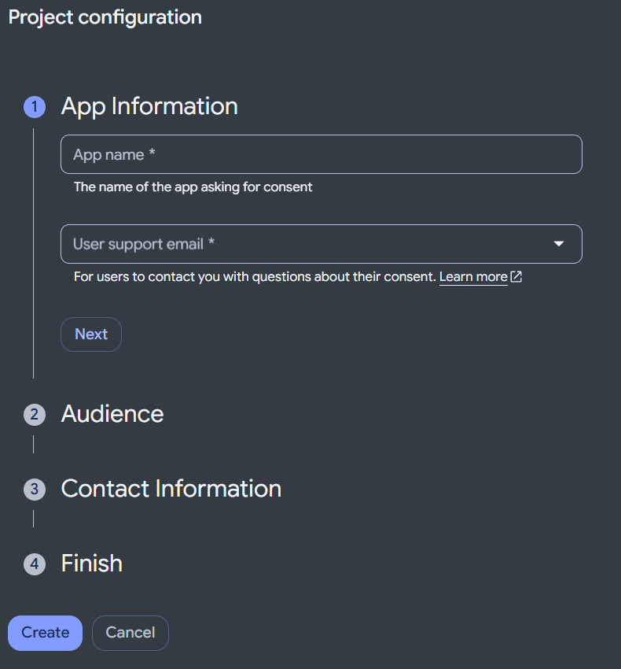
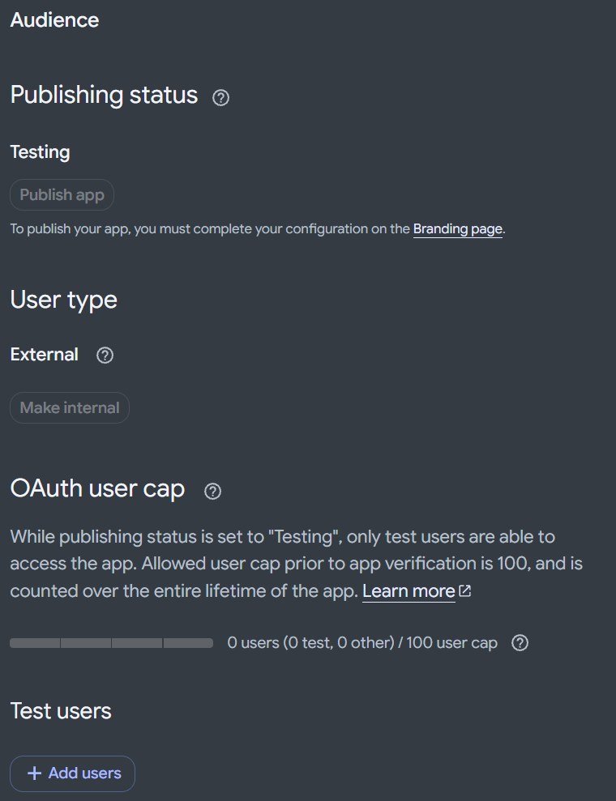
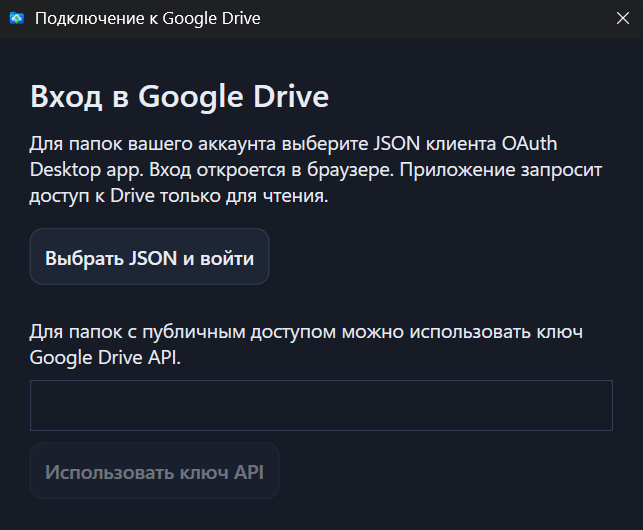

# Диск Загрузки

**Скачивание папок Google Drive на Windows с выбором файлов и возобновлением после обрыва.**

Приложение принимает ссылку на папку, показывает её содержимое и сохраняет выбранные файлы с вложенной структурой. В очереди видны прогресс, скорость и состояние каждого файла.

[Установка](#установка) · [Подключение Google Drive](#подключение-google-drive) · [Загрузка файлов](#загрузка-файлов) · [Решение проблем](#решение-проблем) · [Сборка из исходников](#сборка-из-исходников)


## Установка

**Windows 10 или 11 x64.** Среда .NET входит в сборку. Установку и запуск программы можно выполнить без интернета. Подключение к Google и скачивание требуют сети.

| Файл | Как пользоваться |
| --- | --- |
| `DriveDownload-Setup-x64.exe` | Запустите мастер установки. Программа установится для текущего пользователя без прав администратора. По умолчанию файлы программы сохраняются в `%LOCALAPPDATA%\Programs\DriveDownload`, ярлык появляется в меню «Пуск». |
| `DriveDownload.exe` | Запустите переносимую версию напрямую. |

При сборке из репозитория готовые файлы появляются в папке `release`. Установленную версию можно удалить через **Параметры Windows → Приложения**. Скачанные файлы и настройки хранятся отдельно от папки установки.

## Подключение Google Drive

| Какая у вас папка | Способ |
| --- | --- |
| Папка на вашем Диске или папка, которой поделились с конкретным Google-аккаунтом | [Вход через Google с OAuth Desktop](#вход-через-google-с-oauth-desktop) |
| Папка доступна всем по ссылке | [Ключ Google Drive API](#подключение-по-ключу-api) или вход через Google |

### Вход через Google с OAuth Desktop

Проект Google Cloud нужен для создания OAuth-клиента. При входе в приложение выбирайте **аккаунт, который открывает нужную папку в Google Drive**. Аккаунт, управляющий проектом, и аккаунт с доступом к папке могут быть разными.

#### 1. Создайте проект и включите Google Drive API

1. Откройте Google Cloud Console. В верхней панели выберите существующий проект или создайте новый, например **Диск Загрузки**. [Google Cloud Console](https://console.cloud.google.com/)
2. Откройте **APIs & Services → Library**, найдите **Google Drive API** и нажмите **Enable**. Если на странице уже указан статус **Enabled**, переходите к следующему шагу. [Карточка Google Drive API](https://console.cloud.google.com/apis/library/drive.googleapis.com)

<details>
<summary>Скриншот страницы с включённым Drive API</summary>


</details>

#### 2. Настройте экран согласия

1. В том же проекте откройте **Google Auth Platform → Branding**. При первой настройке нажмите **Get Started**.
2. В **App Information** укажите имя приложения, которое увидите при входе, и выберите **User support email**.
3. В **Audience** выберите **External** для личного Gmail или аккаунтов вне вашей организации. Вариант **Internal** доступен для проектов Google Workspace, предназначенных для пользователей своей организации.
4. В **Contact Information** укажите адрес для уведомлений Google. Примите условия и нажмите **Create**. [Настройка экрана согласия Google](https://developers.google.com/workspace/guides/configure-oauth-consent)

<details>
<summary>Скриншот формы настройки проекта</summary>



</details>

#### 3. Добавьте нужный аккаунт в Test users

Если вы выбрали **External** и проект находится в статусе **Testing**, откройте **Google Auth Platform → Audience → Test users → Add users**. Введите полный адрес аккаунта, с которого будете входить в загрузчик, и нажмите **Save**.

Перед входом откройте ссылку на папку в браузере под этим аккаунтом. Так можно проверить, что Drive действительно дал ему доступ. Список **Test users** разрешает вход в OAuth-приложение. Доступ к самой папке задаёт владелец в Google Drive. [Режимы OAuth-приложений Google](https://developers.google.com/identity/protocols/oauth2/production-readiness/overview)

<details>
<summary>Где находится кнопка Add users</summary>



</details>

#### 4. Добавьте разрешение на чтение Drive

В **Google Auth Platform → Data Access** откройте **Add or remove scopes** и добавьте разрешение `https://www.googleapis.com/auth/drive.readonly`. Сохраните изменения. Загрузчик запрашивает это разрешение, чтобы читать каталог и скачивать файлы, доступные аккаунту. [Разрешения Google Drive API](https://developers.google.com/workspace/drive/api/guides/api-specific-auth)

#### 5. Создайте OAuth-клиент Desktop app и скачайте JSON

1. В **Google Auth Platform → Clients** нажмите **Create client**. На экране **Overview** та же команда может называться **Create OAuth client**.
2. В **Application type** выберите **Desktop app**, задайте имя и нажмите **Create**. Приложение использует локальный адрес для возврата из браузера, поэтому тип **Desktop app** подходит для этого входа.
3. В диалоге создания нажмите **Download JSON** и сохраните файл до закрытия окна. Храните его в личной папке вне репозитория. [Создание OAuth-клиента](https://developers.google.com/workspace/guides/create-credentials#desktop-app) · [Управление OAuth-клиентами](https://support.google.com/cloud/answer/15549257)

<details>
<summary>Где выбрать Desktop app</summary>


</details>

#### 6. Войдите в «Диск Загрузки»

1. Откройте приложение и нажмите индикатор **Google не подключён** в правом нижнем углу.
2. В окне **Подключение к Google Drive** нажмите **Выбрать JSON и войти** и укажите скачанный файл.
3. В открывшемся браузере выберите аккаунт, которому доступна папка. Если проект в режиме **Testing**, используйте аккаунт из **Test users**.
4. Проверьте имя своего приложения в окне согласия Google и подтвердите доступ на чтение.
5. Дождитесь сообщения о завершении входа в браузере и вернитесь к загрузчику. Зелёный индикатор **Google подключён** означает, что данные входа сохранены. Для проверки доступа вставьте ссылку и откройте список файлов синей кнопкой слева от кнопки скачивания.

<details>
<summary>Какую кнопку нажать в окне подключения</summary>



</details>

> В режиме **External → Testing** токен обновления для доступа к Drive действует семь дней. Если вход истёк, нажмите индикатор Google и снова пройдите вход через тот же OAuth JSON. [Срок действия OAuth-токенов](https://developers.google.com/identity/protocols/oauth2#expiration)

Настройки подключения хранятся в `%LOCALAPPDATA%\DriveDownload` в зашифрованном виде для текущего пользователя Windows. После переноса программы на другой ПК выполните подключение в приложении под нужным аккаунтом.

### Подключение по ключу API

Этот вариант подходит для общедоступных папок. Проверьте ссылку в приватном окне браузера без входа в Google. Для закрытой папки используйте OAuth.

1. Выберите проект с включённым Google Drive API. Откройте **APIs & Services → Credentials → Create credentials → API key**.
2. В настройках ключа в **API restrictions** выберите **Restrict key**, укажите **Google Drive API** и сохраните.
3. В загрузчике нажмите индикатор Google в правом нижнем углу. Вставьте ключ в нижнее поле диалога и нажмите **Использовать ключ API**.
4. Убедитесь, что появился индикатор **Доступ по ключу API**. Откройте список файлов по ссылке, чтобы проверить ключ и доступ. [Создание и ограничение API-ключа](https://developers.google.com/workspace/guides/create-credentials#api-key)

## Загрузка файлов

1. Скопируйте полную ссылку на папку вида `https://drive.google.com/drive/folders/…` вместе с параметрами ссылки, если они есть.
2. Нажмите жёлтую иконку папки рядом с полем **Куда сохранить** и выберите каталог на диске.
3. Нажмите **Скачать всё** или откройте список синей иконкой слева. Отметьте нужные файлы и подпапки, затем нажмите **Скачать выбранное**.
4. Готовые файлы появятся внутри подпапки с именем папки Google Drive. Внутренняя структура сохраняется. Кнопка **Открыть папку** открывает результат в Проводнике.

### Пауза и возобновление

- При временном обрыве загрузчик повторяет запрос и продолжает обычный файл с сохранённого байта, когда Drive поддерживает частичную передачу. При ограничении квоты приложение ждёт не менее трёх минут для повторной попытки.
- **Пауза** сохраняет полученные данные. Для ручного возобновления оставьте ту же ссылку и папку назначения и нажмите **Скачать / продолжить** или **Продолжить выбранное**.
- При закрытии окна во время активной передачи загрузчик пытается продолжить это задание при следующем открытии. Выбор файлов сохраняется.
- Служебная папка `.drive-download` внутри каталога назначения нужна для докачки. Храните её до завершения передачи.
- Для готовых файлов проверяется размер и контрольная сумма, если Google её предоставил. При несовпадении приложение покажет конфликт и сохранит существующий файл.

Google Docs, Sheets, Slides и Drawings экспортируются в `.docx`, `.xlsx`, `.pptx` и `.pdf` соответственно. При повторной попытке экспорт начинается заново. [Загрузка и экспорт в Google Drive](https://developers.google.com/workspace/drive/api/guides/manage-downloads)

## Решение проблем

| Что видно | Что проверить |
| --- | --- |
| **Access blocked** или **Error 403: access_denied** во время входа | Откройте **Audience → Test users** в проекте, из которого скачали JSON. Убедитесь, что в списке указан полный адрес аккаунта из окна входа. Для рабочего аккаунта проверьте ограничения организации у администратора. |
| **Google hasn’t verified this app** | Сверьте название с собственным проектом Google Cloud и проверьте запрошенные разрешения. Для своего тестового OAuth-клиента Google описывает переход через **Advanced**. [Справка Google по OAuth](https://developers.google.com/workspace/drive/api/troubleshoot-authentication-authorization) |
| Загрузчик сообщает, что нужен JSON клиента **Desktop app** | В **Clients** проверьте тип клиента. Скачайте JSON для **Desktop app** и выберите скачанный файл через **Выбрать JSON и войти**. |
| **Google Drive API** выключен | Включите API в том же проекте, которому принадлежит выбранный OAuth-клиент или ключ. |
| Браузер не завершает вход | Оставьте окно загрузчика открытым во время входа и завершите его на том же ПК. При повторной попытке заново нажмите **Выбрать JSON и войти**. |
| Папка открывается у коллеги, а загрузчик сообщает, что она недоступна | Откройте ссылку в браузере под аккаунтом, выбранным при OAuth-входе. Попросите владельца выдать доступ этому аккаунту и проверить разрешение на скачивание. |
| Вход работал, а спустя неделю Google просит подключиться снова | В режиме **Testing** повторите вход через индикатор Google. |
| Файл долго остаётся в ожидании | Посмотрите состояние в очереди. При ограничении Drive приложение показывает время следующей попытки. Проверьте, что ПК остаётся включённым, а диск назначения доступен. |

## Сборка из исходников

Для сборки нужны .NET 8 SDK и Windows. Для упаковки установщика нужен [NSIS 3](https://nsis.sourceforge.io/Download). Выполните команды из корня проекта.

```powershell
dotnet run --project tests/DriveDownload.Checks.csproj -c Release
dotnet publish -c Release -r win-x64 --self-contained true -p:PublishSingleFile=true -p:IncludeNativeLibrariesForSelfExtract=true -p:DebugType=None -p:DebugSymbols=false -o release
powershell -File installer/Build-Installer.ps1
```

Если используете переносимый NSIS, передайте полный путь к `makensis.exe` через `-MakeNsis`. Результат появится в `release/DriveDownload-Setup-x64.exe`. [Скрипты установщика](installer/)

[Архитектура проекта](docs/architecture/README.md) · [Статус разработки](STATUS.md)

Google Drive — товарный знак Google LLC. Значок источника взят из [материалов Google для интеграций с Drive](https://developers.google.com/workspace/drive/api/guides/branding).
