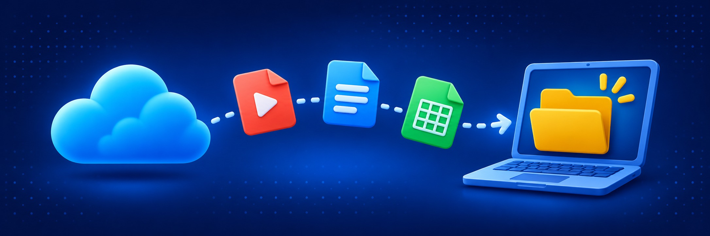
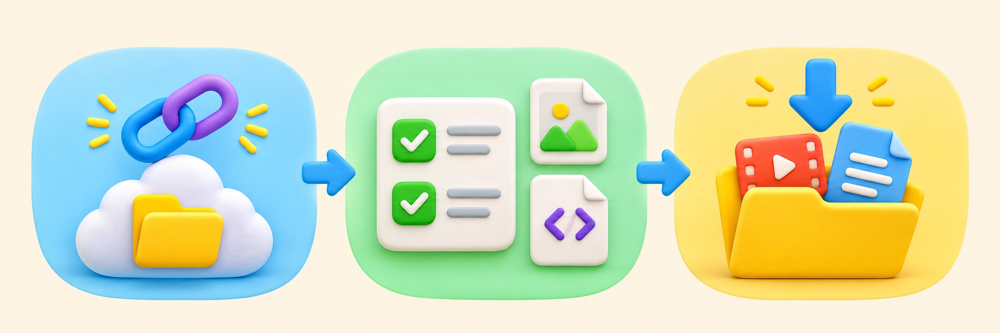
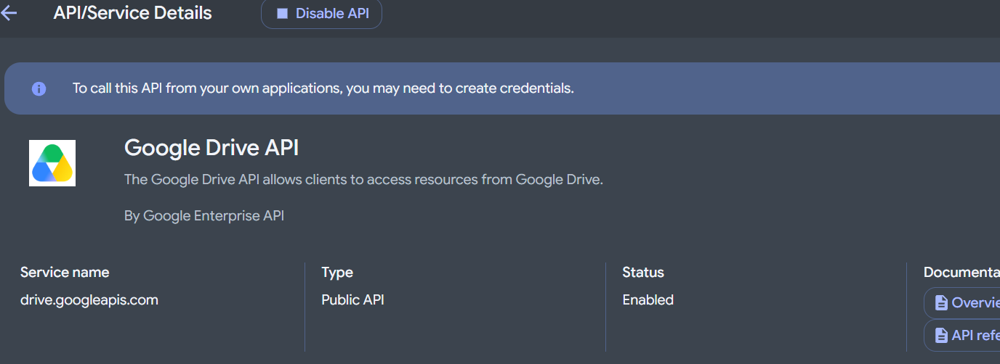
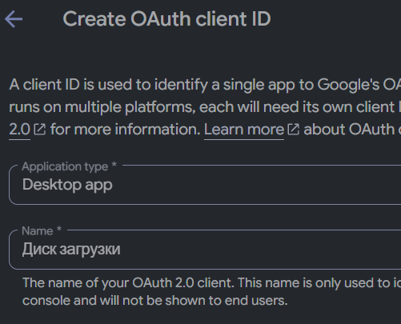

# Диск Загрузки

**Скачивайте папки с Google Drive на Windows.** Можно забрать всё сразу или выбрать нужные файлы галочками. Если интернет пропадёт, загрузчик попробует продолжить с места обрыва.

[🚀 Быстрый старт](#быстрый-старт) · [💻 Установка](#установка) · [🔑 Подключение Google Drive](#подключение-google-drive) · [📥 Загрузка файлов](#загрузка-файлов) · [🛟 Помощь](#решение-проблем)

## Быстрый старт



1. 🔗 **Вставьте ссылку** на папку Google Drive.
2. ✅ **Выберите папку на ПК и файлы.** Жёлтая иконка открывает выбор папки, синяя — список файлов с галочками.
3. 📂 **Начните скачивание.** Нажмите **Скачать всё** или **Скачать выбранное**, если отметили только нужные файлы.

💡 **Открываете программу впервые?** Сначала [установите её](#установка), затем [подключите Google Drive](#подключение-google-drive). После входа статус внизу справа станет зелёным.

<details>
<summary>🖼️ Посмотреть главное окно</summary>


</details>

## Установка

💻 Подойдёт компьютер с **Windows 10 или 11 x64**. Среда .NET уже в комплекте. Интернет понадобится для входа в Google и скачивания файлов.

- 📦 **С установщиком.** Запустите `DriveDownload-Setup-x64.exe` и следуйте мастеру. Права администратора не нужны. После установки ищите **Диск Загрузки** в меню «Пуск».
- ⚡ **Переносимая версия.** Запустите `DriveDownload.exe` двойным щелчком.

Готовые файлы после [сборки](#сборка-из-исходников) находятся в папке `release`.

<details>
<summary>📁 Куда устанавливается программа и как её удалить</summary>

Папка по умолчанию — `%LOCALAPPDATA%\Programs\DriveDownload`. Удалить программу можно в **Параметры Windows → Приложения**. Загруженные файлы и настройки хранятся отдельно.

</details>

## Подключение Google Drive

Выберите способ по тому, **кто может открыть вашу папку**.

- 🔒 **Папка личная или открыта конкретным людям.** [Войдите через Google с OAuth Desktop](#вход-через-google-с-oauth-desktop).
- 🌍 **Папку открывает любой, у кого есть ссылка.** Используйте [ключ API](#подключение-по-ключу-api) или войдите через Google.

### Вход через Google с OAuth Desktop

🎯 Сначала проверьте в браузере, что нужная папка открывается под вашим Google-аккаунтом. **Именно этот аккаунт выбирайте при входе в загрузчик.** Настраивать проект Google Cloud может другой аккаунт.

#### 1️⃣ Включите Google Drive API

1. Откройте Google Cloud Console. В верхней панели выберите проект или создайте новый, например **Диск Загрузки**. [Открыть Google Cloud Console](https://console.cloud.google.com/)
2. Перейдите в **APIs & Services → Library → Google Drive API** и нажмите **Enable**. Если уже видите **Enabled**, шаг готов. [Открыть страницу Drive API](https://console.cloud.google.com/apis/library/drive.googleapis.com)

<p align="center">
  
</p>

#### 2️⃣ Настройте экран входа

В том же проекте откройте **Google Auth Platform → Branding → Get Started**. Затем заполните три блока.

- 🏷️ **App Information.** Укажите имя приложения и выберите **User support email**. Это имя вы увидите при входе через Google.
- 👥 **Audience.** Выберите **External** для личного Gmail или людей за пределами вашей организации. **Internal** подходит для проекта Google Workspace, доступного только внутри организации.
- ✉️ **Contact Information.** Укажите адрес для уведомлений Google, примите условия и нажмите **Create**. [Справка по экрану согласия](https://developers.google.com/workspace/guides/configure-oauth-consent)

<details>
<summary>🖼️ Посмотреть поля на экране Branding</summary>


</details>

#### 3️⃣ Добавьте себя в Test users

Этот шаг нужен, если в **Audience** указаны **External** и **Testing**.

Откройте **Google Auth Platform → Audience**. Найдите раздел **Test users**, нажмите **Add users**, введите полный адрес аккаунта, которым будете входить, и нажмите **Save**.

💡 **Кого добавлять?** Укажите аккаунт, который открывает папку в Google Drive. **Test users** разрешает вход в приложение. Права на папку по-прежнему выдаёт её владелец. [Режимы OAuth в Google](https://developers.google.com/identity/protocols/oauth2/production-readiness/overview)

<p align="center">
  
</p>

#### 4️⃣ Разрешите чтение файлов

Откройте **Google Auth Platform → Data Access → Add or remove scopes**, добавьте строку ниже и сохраните изменения.

```text
https://www.googleapis.com/auth/drive.readonly
```

Так загрузчик сможет читать список файлов и скачивать то, что доступно вашему аккаунту. [Разрешения Drive API](https://developers.google.com/workspace/drive/api/guides/api-specific-auth)

#### 5️⃣ Скачайте файл для входа

1. Перейдите в **Google Auth Platform → Clients → Create client**. Если вы на странице **Overview**, кнопка называется **Create OAuth client**.
2. В **Application type** выберите **Desktop app**. Введите любое понятное имя, например **Диск Загрузки**, и нажмите **Create**.
3. Нажмите **Download JSON**, пока открыто окно создания клиента. Сохраните файл у себя на компьютере, вне Git. [Как создать OAuth-клиент Desktop app](https://developers.google.com/workspace/guides/create-credentials#desktop-app) · [Управление клиентами](https://support.google.com/cloud/answer/15549257)

<details>
<summary>🖼️ Где выбрать Desktop app</summary>



</details>

#### 6️⃣ Войдите в загрузчик

1. Нажмите 🔴 **Google не подключён** справа внизу окна.
2. Выберите **Выбрать JSON и войти**, затем укажите файл из предыдущего шага.
3. В браузере выберите нужный аккаунт, проверьте имя своего приложения и подтвердите доступ на чтение.
4. Вернитесь в загрузчик. Статус 🟢 **Google подключён** означает, что вход сохранён. Вставьте ссылку и откройте список файлов синей кнопкой, чтобы проверить доступ к папке.

<p align="center">
  
</p>

> [!NOTE]
> Если в проекте выбран режим **External → Testing**, токен обновления для Drive действует семь дней. Когда Google попросит войти снова, нажмите индикатор подключения и выберите тот же JSON. [Срок действия токенов](https://developers.google.com/identity/protocols/oauth2#expiration)

🔐 Приложение хранит данные подключения в `%LOCALAPPDATA%\DriveDownload` в зашифрованном виде для текущего пользователя Windows. На другом ПК войдите в Google через загрузчик заново.

### Подключение по ключу API

🌍 Откройте ссылку на папку в приватном окне браузера без входа в Google. Если видите файлы, попробуйте этот способ.

1. В проекте с включённым Drive API откройте **APIs & Services → Credentials → Create credentials → API key**.
2. Откройте настройки ключа. В **API restrictions** выберите **Restrict key**, укажите **Google Drive API** и сохраните.
3. В загрузчике нажмите индикатор Google внизу справа, вставьте ключ в нижнее поле и нажмите **Использовать ключ API**.
4. При статусе **Доступ по ключу API** откройте список файлов по ссылке, чтобы проверить ключ. [Справка по ключам API](https://developers.google.com/workspace/guides/create-credentials#api-key)

## Загрузка файлов

1. 🔗 Вставьте полную ссылку на папку, например `https://drive.google.com/drive/folders/…`. Скопируйте и параметры, если они есть.
2. 📁 Нажмите жёлтую иконку у поля **Куда сохранить** и выберите каталог.
3. ✅ Нажмите **Скачать всё**. Если нужна только часть файлов, откройте список синей иконкой, расставьте галочки и нажмите **Скачать выбранное**.
4. 🎉 Нажмите **Открыть папку**, когда захотите увидеть результат. В каталоге назначения появится подпапка с именем из Google Drive. Вложенные папки останутся на своих местах.

### Пауза и возобновление

- 🌐 **Пропал интернет.** Загрузчик повторит запрос и продолжит файл с сохранённого места, если Drive поддерживает частичную передачу. При ограничении квоты повтор для файла будет через три минуты или позже.
- ⏸️ **Поставили на паузу.** Оставьте ту же ссылку и папку назначения. Нажмите **Скачать / продолжить** или **Продолжить выбранное**.
- 🔄 **Закрыли окно во время загрузки.** При следующем открытии приложение попробует возобновить задание. Галочки сохраняются.

> [!TIP]
> Оставьте папку `.drive-download` в каталоге назначения, пока скачивание не закончится. В ней хранятся данные для продолжения.

<details>
<summary>📄 Как проверяются файлы и в каком формате сохраняются документы</summary>

Для готовых файлов приложение проверяет размер и контрольную сумму, если Drive её предоставил. Если существующий файл отличается, загрузчик покажет конфликт и сохранит этот файл.

Google Docs, Sheets, Slides и Drawings сохраняются как `.docx`, `.xlsx`, `.pptx` и `.pdf` соответственно. Если экспорт оборвался, следующая попытка начнётся с начала документа. [Справка Drive по скачиванию и экспорту](https://developers.google.com/workspace/drive/api/guides/manage-downloads)

</details>

## Решение проблем

<details>
<summary>🚧 Google показывает Access blocked или ошибку 403: access_denied</summary>

Убедитесь, что в проекте, из которого получен JSON, нужный аккаунт добавлен в **Audience → Test users**. Если вы входите с рабочей почтой, проверьте у администратора, разрешён ли доступ для этого OAuth-приложения.

</details>

<details>
<summary>🛡️ Google пишет «Это приложение не проверено»</summary>

Сверьте имя приложения со своим проектом Google Cloud и проверьте разрешения. Для собственного тестового OAuth-клиента Google описывает действия в разделе **Advanced**. [Справка Google](https://developers.google.com/workspace/drive/api/troubleshoot-authentication-authorization)

</details>

<details>
<summary>📄 Загрузчик просит JSON для Desktop app или сообщает, что API выключен</summary>

Откройте **Google Auth Platform → Clients** и скачайте JSON клиента с типом **Desktop app**. Проверьте, что именно в этом проекте включён **Google Drive API**. Если вы используете ключ API, проверьте проект, в котором его создали.

</details>

<details>
<summary>🌐 Вход завис в браузере</summary>

Оставьте окно загрузчика открытым и завершите вход на том же компьютере. Для новой попытки снова нажмите **Выбрать JSON и войти**. Если вход работал около недели и теперь требует подтверждения, проверьте статус **Testing** и повторите вход.

</details>

<details>
<summary>🔒 Загрузчик пишет, что папка недоступна</summary>

Откройте ссылку в браузере под тем же аккаунтом, который выбрали при входе в загрузчик. Попросите владельца дать этому аккаунту доступ к папке и проверить разрешение на скачивание.

</details>

<details>
<summary>⏳ Файл долго остаётся в ожидании</summary>

Посмотрите состояние в очереди. При ограничении Drive загрузчик показывает время следующей попытки. Проверьте, что компьютер включён, интернет работает и диск назначения доступен.

</details>

## Сборка из исходников

<details>
<summary>🛠️ Открыть команды сборки и установщика</summary>

Для сборки нужны Windows и .NET 8 SDK. Для установщика понадобится [NSIS 3](https://nsis.sourceforge.io/Download). Выполните команды из корня проекта.

```powershell
dotnet run --project tests/DriveDownload.Checks.csproj -c Release
dotnet publish -c Release -r win-x64 --self-contained true -p:PublishSingleFile=true -p:IncludeNativeLibrariesForSelfExtract=true -p:DebugType=None -p:DebugSymbols=false -o release
powershell -File installer/Build-Installer.ps1
```

Если NSIS распакован отдельно, передайте полный путь к `makensis.exe` через параметр `-MakeNsis`. Установщик появится в `release/DriveDownload-Setup-x64.exe`. [Скрипты установщика](installer/)

</details>

[Архитектура](docs/architecture/README.md) · [Статус разработки](STATUS.md)

Google Drive — товарный знак Google LLC. Значок источника взят из [материалов Google для интеграций с Drive](https://developers.google.com/workspace/drive/api/guides/branding).
