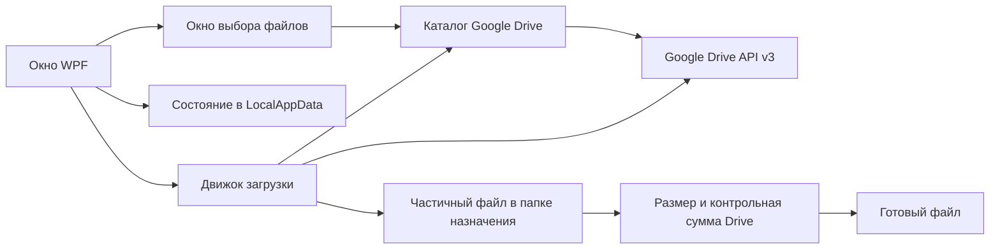

# Архитектура Windows-приложения «Диск Загрузки»

Проверено 20.11.2026 по исходникам и локальному тесту. Снимок рабочего каталога без Git-коммита.

| Компонент | Ответственность |
| --- | --- |
| `MainWindow.xaml`, `MainWindow.xaml.cs` | Ссылка, выбор пути, индикаторы и очередь. WPF отображает состояние движка по таймеру. |
| `GoogleDrive.cs` | OAuth Desktop app с PKCE и локальным callback. Google Drive API v3 для списка, бинарных файлов и экспорта. |
| `DriveCatalog.cs` | Читает дерево с пагинацией и назначает допустимые для Windows имена. Работает с метаданными Drive. |
| `SelectionWindow.xaml`, `SelectionWindow.xaml.cs` | Показывают дерево, размер файлов и выбор с галочками. Галочка папки отмечает доступные дочерние элементы. |
| `DownloadEngine.cs` | Фильтрует каталог по заданию, ведёт до трёх передач, докачивает байты и публикует файл после проверки. |
| `State.cs` | Парсинг ссылки, сохранение активного задания и шифрование настроек подключения через Windows DPAPI. |

При запуске движок читает дерево и назначает допустимые для Windows имена. В именах временных файлов учтены ID, версия, размер, контрольная сумма Drive и путь назначения. При обрыве следующий запрос передаёт HTTP Range. Движок проверяет Content-Range и объём перед переносом. Файлы экспортируемых типов Google при повторе загружаются с начала. Ссылки и точки подключения в цепочке локального пути отклоняются. При конфликте локальное содержимое сохраняется.

Задание и ID кэша переживают закрытие приложения. Сохранённое активное задание автоматически запускается при следующем открытии. Транспортные ошибки повторяются с увеличивающейся паузой. Для квоты Drive используется интервал от 180 секунд с учётом Retry-After. Ответы о запрете доступа отображаются как ошибки очереди.

Приложение использует Google Drive API для доступа только на чтение и принимает пользовательский OAuth Desktop JSON или API key для публичных папок. Содержимое файлов не отправляется в сторонние сервисы.

Проверено локально: пагинация, разрыв HTTP-потока, Range с сохранённого смещения, полнота файла по MD5, повторная сверка готовой копии, сохранение конфликта и обработка ответа квоты. 20.11.2026 пользователь подключил OAuth Desktop JSON и скачал рабочую папку CH-05 за 20 ноября. На диске сверены размеры всех 10 AVI.
При предпросмотре каталог читает только метаданные. После подтверждения в job.json записывается SelectedKeys: ключи файлов и пустых папок по цепочкам идентификаторов Drive. При повторном открытии движок перечитывает каталог и берёт те же ключи. В задании прежнего формата отсутствие SelectedKeys означает загрузку всего дерева. Существующий кэш используется для той же ссылки и папки назначения.

Тема главного окна и окна выбора использует встроенную растровую текстуру. WindowBackdrop.cs настраивает фоновую кисть под DPI монитора при открытии окна и при смене масштаба.

В главном окне настройка доступа и индикатор Google находятся в нижней строке. MainWindow обновляет индикатор по сохранённым OAuth-данным или ключу API, а основной цвет окантовки панелей задаётся в Theme.xaml.
